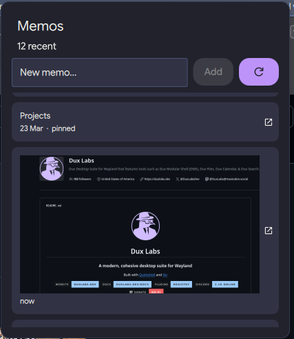

# Memos



Bar widget for [Dux / DankMaterialShell](https://github.com/duxlabs-dev/dux-shell) that reads a
[Memos](https://github.com/usememos/memos) server: memo count (or the latest memo text) in the pill,
recent memos in a popout — images as thumbnails, documents as icon + filename, pinned first.

- Click a memo to copy it; the arrow opens it in the Memos web UI.
- Compose a new memo from the popout (`New memo…` → Add), refresh with the ↻ button.
- Optional clipboard watcher: after a copy/cut a notification offers **Save to Memo** (text saved as a
  memo, images uploaded as an attachment and shown as a thumbnail in the prompt).

## Install

```bash
git clone https://github.com/fepfitra/dms-memos ~/.config/DankMaterialShell/plugins/dms-memos
```

Then Settings → Plugins → Scan for Plugins → enable **Memos**, add it to the bar, `dms restart`.

## Settings

| Key | Meaning |
|---|---|
| Server URL | Base URL, e.g. `https://memos.example.com` |
| Access token | Memos → Settings → Access tokens |
| Refresh interval | Minutes between polls |
| Memos to show | 1-50, also caps the popout |
| Show latest memo text in the bar | Off shows the count |
| Prompt to save new clipboard text/images | Notification with a Save button on copy |
| Clipboard minimum length | Ignore shorter copied text |

## Notes

- REST only: `GET /api/memos`, `POST /api/memos`, `POST /api/attachments`, plus
  `GET /api/memos?filter=pinned` so pinned memos outside the recent window still show.
- Attachment files (`/file/attachments/<uid>/<file>`) need the token, so thumbnails are fetched with
  `curl` into `/tmp/dms-memos-cache` and rendered from disk.
- The token is passed as a curl argv element, i.e. visible to processes of the same user.

MIT.
